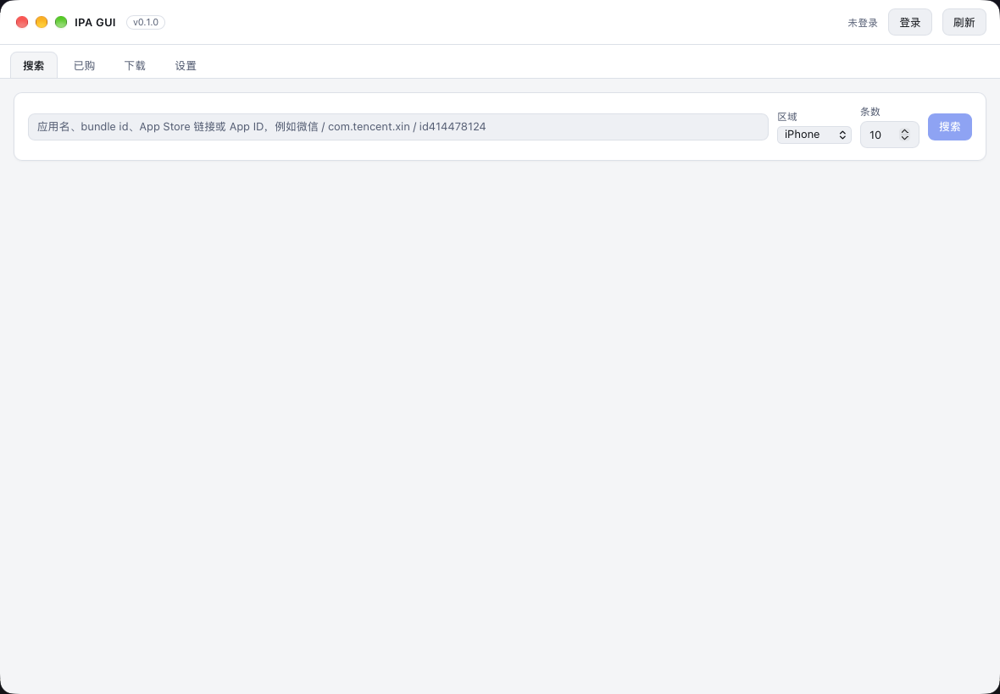

# IPA GUI

**[English](#english)** · **[简体中文](#chinese)**

A Wails desktop GUI for downloading IPAs of App Store apps **you already own**,
built on top of [ipatool](https://github.com/majd/ipatool).





---

<a id="english"></a>

## What it is

`ipagui` wraps the Go business layer of ipatool (`pkg/appstore`) in a native
desktop application, so the whole flow is a few clicks instead of a chain of
CLI commands:

- sign in to the App Store with your own Apple ID (2FA supported)
- search the store, inspect app details and version history
- download an IPA with resumable transfer and byte-accurate progress
- keep a local SQLite index of what you downloaded, with hashes
- optionally expose the same capabilities as an MCP server (`cmd/ipa-mcp`)

Backend: Go + Wails v2. Frontend: React 19 + Vite. macOS and Windows.

## Requirements

| | |
|---|---|
| Go | 1.26.5 or newer (pinned by `go.mod`) |
| Wails CLI | v2 (`go install github.com/wailsapp/wails/v2/cmd/wails@v2.16.0`) |
| Node.js | 20+ (for the frontend build) |
| macOS | Xcode Command Line Tools |
| Windows | WebView2 runtime (preinstalled on Windows 11) |

## Build

```bash
# 1. frontend deps
cd frontend && npm ci && cd ..

# 2. build (frontend is built automatically)
wails build
```

Platform helper scripts:

```bash
./scripts/build-macos.sh            # macOS, arm64 by default; pass amd64 for Intel
pwsh scripts/build-windows.ps1      # Windows, amd64 by default; pass arm64
```

### Note on `go:embed`

`main.go` embeds the frontend build output:

```go
//go:embed all:frontend/dist
var assets embed.FS
```

Only `frontend/dist/.gitkeep` is tracked. A fresh clone therefore *compiles*
with a bare `go build` — but the embedded assets are empty and the app opens a
blank window. Run `wails build` (it builds the frontend first), or
`npm ci && npm run build` inside `frontend/`, before `go build`, to get a
usable binary.

`npm run build` (and therefore `wails build`) wipes `frontend/dist`, including
the tracked `.gitkeep`. The platform build scripts restore it automatically;
if you build the frontend by hand, run `git checkout -- frontend/dist/.gitkeep`
afterwards to keep the work tree clean.

## Usage limits — please read

This tool is for **personal backup of apps you have already purchased with your
own Apple ID**. It is not:

- a way to obtain apps you have not paid for;
- an account provider — it never ships or shares Apple IDs;
- a redistribution tool for IPAs;
- a way around App Store purchase, licensing, or DRM checks.

Known risks, stated plainly:

- Automating App Store sign-in **can get your Apple ID disabled**. Upstream
  reports: [ipatool#584](https://github.com/majd/ipatool/issues/584),
  [ipatool#627](https://github.com/majd/ipatool/issues/627). Use a secondary
  account if you care about the primary one.
- Downloaded IPAs remain FairPlay-encrypted App Store binaries. They are not
  decrypted by this project.
- No warranty of any kind. See `LICENSE`.

## Where data lives

| Path | Contents |
|---|---|
| `~/.ipatool/` | Login state (cookies, account files), **shared with the official `ipatool` CLI** |
| `~/.ipatool/` keychain item `ipatool-auth.service` | Credentials, shared with the official CLI |
| `~/Library/Application Support/ipagui/settings.json` (macOS) | App settings |
| `%AppData%\ipagui\settings.json` (Windows) | App settings |
| `~/Library/Application Support/ipagui/library.db` (macOS) | Local download index (SQLite) |
| `%AppData%\ipagui\library.db` (Windows) | Local download index (SQLite) |
| `~/Downloads/IPA` | Default download directory (configurable) |

### Credential storage

- **macOS**: the system Keychain. App settings (including the download
  directory and the file-passphrase reference) live under the service name
  `ipagui.settings`.
- **Windows**: ipatool's **file backend**, *not* Windows Credential Manager.
  Credentials are protected by a passphrase the app asks you to set, stored in
  the `ipagui.settings` namespace. This is a deliberate upstream constraint, not
  an oversight.

## Relation to upstream ipatool

`third_party/ipatool/` is a modified copy of
[majd/ipatool](https://github.com/majd/ipatool) v2.8.0, wired in via a Go
`replace` directive:

```text
replace github.com/majd/ipatool/v2 => ./third_party/ipatool
```

Local patches are documented in
[`third_party/ipatool/FORK.md`](third_party/ipatool/FORK.md):

1. a FairPlay fallback so a download never produces an IPA whose binary is
   encrypted but carries no valid `sinf`;
2. an Apple CDN `User-Agent` fix (upstream now has an equivalent fix).

The directory contains ~6.4 MB of upstream-generated asset data
(`internal/store/profile/data_generated.go`). It comes from upstream's pinned
inputs, not from this project — see `NOTICE`.

## License

MIT. See [`LICENSE`](LICENSE) and [`NOTICE`](NOTICE) for third-party
attribution (`third_party/ipatool` is MIT, © Majd Alfhaily) and dependency
license notes.

## Contact

Please open an issue in this repository.

---

<a id="chinese"></a>

## 简体中文

**[English](#english)** · **简体中文**

`ipagui` 是一个 Wails 桌面应用，把 [ipatool](https://github.com/majd/ipatool)
的 Go 业务层（`pkg/appstore`）包成了图形界面，把「登录 → 搜索 → 版本考古 →
下载（可续传、精确进度）→ 本地库检索」压缩成几步点击，另带一个可选的
MCP helper（`cmd/ipa-mcp`）。

### 环境要求

- Go 1.26.5 或以上（`go.mod` 已钉版）
- Wails CLI v2
- Node.js 20+（前端构建）
- macOS 需 Xcode CLT；Windows 需 WebView2 运行时

### 构建

```bash
cd frontend && npm ci && cd ..
wails build
```

或直接用 `./scripts/build-macos.sh`、`pwsh scripts/build-windows.ps1`。

**`go:embed` 注意**：`main.go` 用 `//go:embed all:frontend/dist` 嵌入前端产物，
仓库里只跟踪 `frontend/dist/.gitkeep`。所以新 clone 后 `go build` **能编译通过**，
但嵌入的资源是空的，启动会是一个白窗口。要拿到可用的二进制，先 `wails build`
（会自动构建前端），或先 `npm ci && npm run build` 再 `go build`。

另外 `npm run build` 会清空 `frontend/dist`（包括 `.gitkeep`）。两个构建脚本结尾会自动补回；
如果你是手动构建前端，构完执行 `git checkout -- frontend/dist/.gitkeep` 保持工作区干净。

### 用途与限制

仅用于**备份你自己用本人 Apple ID 已购买的 App**。本工具不提供账号、不用于
获取未付费内容、不用于分发 IPA、不绕过 App Store 的购买/授权/DRM 检查。

已知风险：

- 自动化登录 **有可能导致 Apple ID 被停用**（上游报告：
  [#584](https://github.com/majd/ipatool/issues/584)、
  [#627](https://github.com/majd/ipatool/issues/627)）。在意主账号的话请用小号。
- 下载到的 IPA 仍是 FairPlay 加密的商店二进制，本项目不做解密。
- 不提供任何担保，详见 `LICENSE`。

### 数据位置

| 路径 | 内容 |
|---|---|
| `~/.ipatool/` | 登录态（与官方 `ipatool` CLI 共用） |
| `~/Library/Application Support/ipagui/`（macOS） | `settings.json` 与本地库 `library.db` |
| `%AppData%\ipagui\`（Windows） | 同上 |
| `~/Downloads/IPA` | 默认下载目录（可修改） |

**凭据存储**：macOS 走系统钥匙串；Windows 走 ipatool 的**文件后端**（不是
Windows 凭据管理器），由你设置的口令保护 —— 这是上游的既有约束。

### 与上游的关系

`third_party/ipatool/` 是 ipatool v2.8.0 的 fork（MIT，© Majd Alfhaily），
通过 `go.mod` 的 `replace` 引入。本地补丁（FairPlay 回退、Apple CDN UA 修复）
记录在 [`third_party/ipatool/FORK.md`](third_party/ipatool/FORK.md)。

### 许可

MIT。第三方归属与依赖许可说明见 [`NOTICE`](NOTICE)。

### 联系

请在本仓库开 issue。
