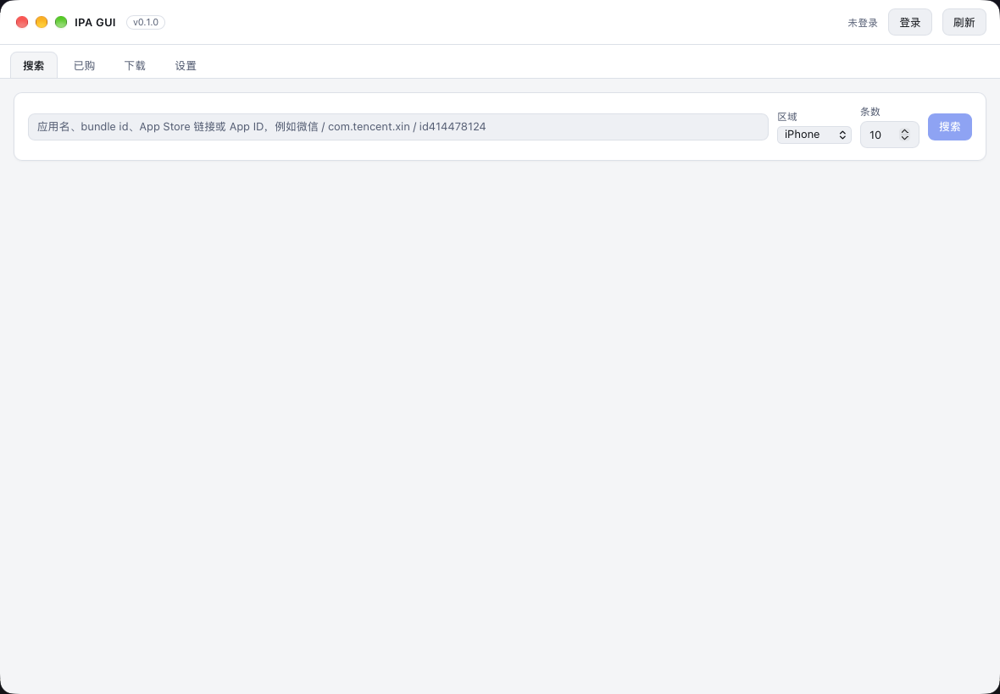

# IPA GUI

**[English](README.md)** · **简体中文**

一个 Wails 桌面应用，用于下载**你自己已购买**的 App Store 应用的 IPA，
基于 [ipatool](https://github.com/majd/ipatool) 构建。





---

## 这是什么

`ipagui` 把 ipatool 的 Go 业务层（`pkg/appstore`）包成了原生桌面应用，
把一串 CLI 操作压缩成几步点击：

- 用你自己的 Apple ID 登录 App Store（支持两步验证）
- 搜索商店、查看应用详情与历史版本
- 下载 IPA，支持断点续传与字节级精确进度
- 用本地 SQLite 账本记录下载过的内容与哈希
- 可选地把同样的能力以 MCP 服务暴露出去（`cmd/ipa-mcp`）

后端 Go + Wails v2，前端 React 19 + Vite，支持 macOS 与 Windows。

## 环境要求

| | |
|---|---|
| Go | 1.26.5 或以上（`go.mod` 已钉版） |
| Wails CLI | v2（`go install github.com/wailsapp/wails/v2/cmd/wails@v2.16.0`） |
| Node.js | 20+（前端构建） |
| macOS | Xcode Command Line Tools |
| Windows | WebView2 运行时（Windows 11 自带） |

## 构建

```bash
# 1. 前端依赖
cd frontend && npm ci && cd ..

# 2. 构建（前端会被自动构建）
wails build
```

平台辅助脚本：

```bash
./scripts/build-macos.sh            # macOS，默认 arm64；Intel 传 amd64
pwsh scripts/build-windows.ps1      # Windows，默认 amd64；传 arm64 构建 ARM 版
```

### 关于 `go:embed`

`main.go` 用下面的方式嵌入前端产物：

```go
//go:embed all:frontend/dist
var assets embed.FS
```

仓库里只跟踪 `frontend/dist/.gitkeep`。所以新 clone 后 `go build` **能编译通过**，
但嵌入的资源是空的，启动会是一个白窗口。要拿到可用的二进制，先 `wails build`
（会自动构建前端），或先 `npm ci && npm run build` 再 `go build`。

另外 `npm run build`（以及 `wails build`）会清空 `frontend/dist`，包括被跟踪的
`.gitkeep`。两个平台脚本结尾会自动补回；如果你是手动构建前端，构完执行
`git checkout -- frontend/dist/.gitkeep` 保持工作区干净。

## 用途与限制

仅用于**备份你自己用本人 Apple ID 已购买的 App**。本工具不是：

- 获取未付费内容的途径；
- 账号提供方 —— 它从不附带或共享 Apple ID；
- IPA 分发工具；
- 绕过 App Store 购买、授权或 DRM 检查的手段。

已知风险，直说：

- 自动化登录 **有可能导致 Apple ID 被停用**。上游报告：
  [ipatool#584](https://github.com/majd/ipatool/issues/584)、
  [ipatool#627](https://github.com/majd/ipatool/issues/627)。
  在意主账号的话，请用副号。
- 下载到的 IPA 仍是 FairPlay 加密的商店二进制，本项目**不做解密**。
- 不提供任何担保，详见 `LICENSE`。

## 数据位置

| 路径 | 内容 |
|---|---|
| `~/.ipatool/` | 登录态（cookies、账号文件），**与官方 `ipatool` CLI 共用** |
| `~/.ipatool/` 下的钥匙串条目 `ipatool-auth.service` | 凭据，与官方 CLI 共用 |
| `~/Library/Application Support/ipagui/settings.json`（macOS） | 应用设置 |
| `%AppData%\ipagui\settings.json`（Windows） | 应用设置 |
| `~/Library/Application Support/ipagui/library.db`（macOS） | 本地下载账本（SQLite） |
| `%AppData%\ipagui\library.db`（Windows） | 本地下载账本（SQLite） |
| `~/Downloads/IPA` | 默认下载目录（可修改） |

### 凭据存储

- **macOS**：系统钥匙串。应用设置（下载目录、文件口令引用）存在服务名
  `ipagui.settings` 下。
- **Windows**：ipatool 的**文件后端**，**不是** Windows 凭据管理器。凭据由你设置的
  口令保护，存在 `ipagui.settings` 命名空间里。这是上游的既有约束，不是本项目的疏漏。

## 与上游 ipatool 的关系

`third_party/ipatool/` 是 [majd/ipatool](https://github.com/majd/ipatool) 上游 `main`
（`3b02b4c`，即 `v2.8.1` 之后 6 个 commit；上游尚未发新 tag，`go.mod` 里钉的版本仍写
`v2.8.1`）的修改副本，通过 Go 的 `replace` 指令接入：

```text
replace github.com/majd/ipatool/v2 => ./third_party/ipatool
```

本地补丁记录在 [`third_party/ipatool/FORK.md`](third_party/ipatool/FORK.md)：

1. FairPlay 回退 —— 避免产出「二进制已加密但没有有效 `sinf`」的 IPA；
2. Apple FCS key 的 `User-Agent`（防御性；镜像下载的 UA 自 v2.8.1 起已由上游提供）；
3. 内置 Apple Root CA 回退（Anisette machine provisioning 的根证书下载地址现在返 403）；
4. 认证响应追踪 —— 设 `IPATOOL_AUTH_TRACE` 才开，默认零开销；
5. 店面发现重试 —— 网络错误 / 429 / 5xx 自动再试两次。

该目录还包含约 6.7 MB 的上游生成数据
（`internal/store/profile/data_generated.go`）。它来自上游的钉版输入，不是本项目生成的 ——
详见 `NOTICE`。

## 许可

MIT。第三方归属（`third_party/ipatool` 为 MIT，© Majd Alfhaily）与依赖许可说明见
[`LICENSE`](LICENSE) 和 [`NOTICE`](NOTICE)。

## 联系

请在本仓库开 issue。
